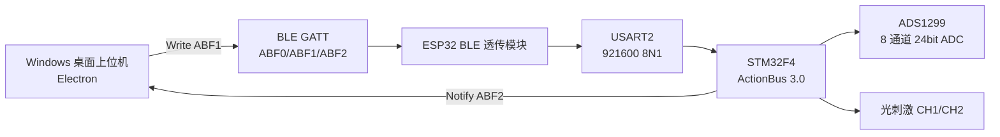

# BrainLume2.0C 设备与通信完整交接文档

| 项目 | 当前值 |
| --- | --- |
| 文档用途 | 交给另一台电脑上的 AI，直接继续桌面上位机开发、修复和实机调试 |
| 设备 | BrainLume2.0C |
| 桌面工程 | `D:\AilongProject\EEG_tls_Upper` |
| 桌面版本 | `0.4.0` |
| SDK | BrainLume JavaScript SDK `1.0.3` |
| 固件工程 | `D:\AilongProject\brainlume2.0c_embedded_code\Software\brainlume2.0c_embedded_code` |
| 总线协议 | ActionBus `3.0` |
| 默认地址 | `0x01` |
| 默认 EEG 通道 | CH2，可切换 CH1~CH8 |
| 默认采样率 | 250 SPS |
| 文档日期 | 2026-08-07 |

> 本文优先描述“当前固件实际代码”，不是只描述上位机的推测。
> 如果 SDK、旧文档和固件定义冲突，以当前固件 `Core/Inc/actionbus.h`、
> `Core/Src/actionbus.c` 和 `Core/Src/brainlume_app.c` 为准。

## 1. 给接手 AI 的第一条指令

先不要重写协议，也不要先改 UI。按下面顺序工作：

1. 阅读本文。
2. 阅读桌面工程 `README.md`。
3. 运行 `npm run check` 和 `npm test`。
4. 修正本文第 12 节列出的已知不一致。
5. 在协议日志中保留错误帧的 `Addr/Func/Stat/Data`，不能只显示异常字符串。
6. 每次改动后运行测试并创建 Git 提交。
7. 实机动作必须串行；任何开始动作都要有停止动作。

## 2. 系统组成



当前 STM32 固件不直接实现 BLE GATT。它通过 USART2 与 ESP32 透传模块交换完整
ActionBus 字节流：

- USART2：`921600 baud`、8 数据位、1 停止位、无校验、无硬件流控。
- STM32 TX：阻塞式 `HAL_UART_Transmit(..., timeout=100ms)`。
- STM32 RX：单字节中断，每收到一个字节喂给 `ActionBus_RxHandler()`。
- BLE Notify 和 Write 的边界不等于 ActionBus 帧边界。

## 3. BLE GATT

当前设备约定：

| 用途 | UUID |
| --- | --- |
| Service | `0000ABF0-0000-1000-8000-00805F9B34FB` |
| 上位机写入 | `0000ABF1-0000-1000-8000-00805F9B34FB` |
| 设备 Notify | `0000ABF2-0000-1000-8000-00805F9B34FB` |

曾用于实机识别的设备 MAC 为 `C8:85:41:6B:D9:9A`。Web Bluetooth 在 Windows 上不保证
把 MAC 直接作为 `device.id` 暴露，因此扫描时同时保存设备 ID 和设备名，不要只按 MAC 匹配。

### 3.1 BLE 接收规则

- Notify 可能只包含半帧。
- 一次 Notify 可能包含多帧。
- Notify 前后可能出现噪声字节。
- 必须保留持久化解析缓冲，从 `AA 55` 重新同步。
- 不能假设“一个 Notify 等于一个 ActionBus 帧”。

### 3.2 BLE 发送规则

- 所有 ActionBus 命令使用单一发送队列。
- 同一时刻只能有一个完整帧在发送。
- 默认按 20 字节分片，等待每个 `writeValueWithoutResponse()` Promise 完成后再写下一片。
- 30 字节 ADS1299 配置的完整 ActionBus 帧长为 38 字节，会拆成两片。
- 不允许两个 ActionBus 帧的分片交叉。
- ActionBus 没有 transaction ID；同 Func 并发会导致响应错误匹配。
- 普通请求收到响应或超时后，才能发送下一个请求。

如设备端仍出现接收异常，可在 BLE 分片之间增加 `2~5ms` 可配置间隔，但必须先确认错误帧
的 Func，不能看到 `0x06` 就直接认定是 BLE 缓冲溢出。

## 4. ActionBus 3.0

### 4.1 帧格式

```text
AA 55 | Addr | Func | Stat | Len | Data[Len] | CRC_H | CRC_L
```

| 字段 | 字节数 | 说明 |
| --- | ---: | --- |
| `AA 55` | 2 | 固定帧头，不参与 CRC |
| `Addr` | 1 | 设备地址，默认 `0x01`；广播为 `0xFF` |
| `Func` | 1 | 功能码 |
| `Stat` | 1 | 方向、开关和错误位 |
| `Len` | 1 | Data 长度，0~255 |
| `Data` | Len | 业务载荷 |
| `CRC_H/L` | 2 | CRC-16/MODBUS，高字节先发送 |

最大帧长：`6 + 255 + 2 = 263` 字节。

CRC 参数：

```text
算法：CRC-16/MODBUS
初值：0xFFFF
反射多项式：0xA001
计算范围：Addr 到 Data 最后一个字节
线路顺序：CRC 高字节先发，再发低字节
```

已知测试向量：

```text
AA 55 01 F0 10 01 00 95 2A
```

### 4.2 Stat

| 位 | 含义 |
| --- | --- |
| bit7 `0x80` | 错误 |
| bit4 `0x10` | 方向，1=主机发出，0=从机发出 |
| bit0 `0x01` | 开关，1=启动/运行，0=停止/完成 |

常用值：

| Stat | 含义 |
| --- | --- |
| `0x11` | 主机请求启动或写配置 |
| `0x10` | 主机查询或停止 |
| `0x01` | 从机运行中/主动上报 |
| `0x00` | 从机正常完成/停止 |
| `0x80` | 从机错误 |

### 4.3 错误帧

错误帧：

```text
Stat = 0x80
Data[0] = errorCode
Data[1..] = 可选附加信息
```

当前固件真实错误码：

| 错误码 | 固件枚举 | 含义 |
| --- | --- | --- |
| `0x01` | `AB_ERR_INVALID_PARAMETER` | 参数非法 |
| `0x02` | `AB_ERR_LEN_OR_PAYLOAD` | 长度或 payload 不符合约定 |
| `0x03` | `AB_ERR_NOT_SUPPORTED` | 功能码或子命令不支持 |
| `0x04` | `AB_ERR_WRONG_STATE` | 当前状态不允许，例如充电时启动 EEG/光刺激 |
| `0x05` | `AB_ERR_BUSY` | 资源忙 |
| `0x06` | `AB_ERR_INTERNAL` | 内部错误 |
| `0x07` | `AB_ERR_PERMISSION` | 权限不足 |
| `0x08` | `AB_ERR_TIMEOUT` | 下位机内部超时 |
| `0x09` | `AB_ERR_CRC` | CRC 错误 |

**重要：桌面工程当前 SDK 的 `DEVICE_ERROR` 映射是旧版错误表。它把 `0x06` 显示成
`Buffer overflow`，这是错误文案。当前固件中的 `0x06` 是 `Internal error`。**

## 5. 连接后的发现流程

主机必须使用 `F0 + FE` 获取完整能力表：

```text
F0/00 协议版本
F0/01 设备 ID
F0/02 Action 数量 N
F0/03 uptime ms
F0/04 总线地址
FE/00 描述表 schema
FE/01 + index，index=0..N-1
0x01 状态查询
```

所有发现请求 `Stat=0x10`。

### 5.1 F0

发送 Data 为 1 字节子命令。F0 响应 **不回显子命令**，必须用当前 pending request 决定解析方式。

| 子命令 | 响应 Data |
| --- | --- |
| `00` | `[Major][Minor]`，当前 `03 00` |
| `01` | 5 字节 ID，当前预期 `02 00 0C 00 01` |
| `02` | 1 字节 Action 数量，当前为 9 |
| `03` | uptime uint32 大端 |
| `04` | 总线地址，当前 `01` |

### 5.2 FE

```text
FE/00：Data = 00
响应：01

FE/01：Data = 01 index
响应：[FuncCode][DescLen][Desc ASCII]
```

当前注册表按 Func 升序枚举：

| index | Func | 描述 |
| ---: | --- | --- |
| 0 | `0x01` | `brainlume status` |
| 1 | `0x10` | `light ch1 cfg` |
| 2 | `0x11` | `light ch2 cfg` |
| 3 | `0x12` | `light ch1 ctrl` |
| 4 | `0x13` | `light ch2 ctrl` |
| 5 | `0x20` | `eeg cfg` |
| 6 | `0x21` | `eeg ctrl` |
| 7 | `0x22` | `eeg raw report` |
| 8 | `0x23` | `eeg reg read` |

## 6. 设备业务功能码

| Func | 名称 | 主机请求 | 正常响应 |
| --- | --- | --- | --- |
| `0x01` | 设备状态 | `Stat=10 Len=0` | `Stat=00 Len=13` |
| `0x10` | 光刺激 CH1 配置 | `Stat=11 Len=6` | 回显 6 字节配置 |
| `0x11` | 光刺激 CH2 配置 | `Stat=11 Len=6` | 回显 6 字节配置 |
| `0x12` | 光刺激 CH1 控制 | `11` 启动，`10` 停止 | 启动 `01/0B`，停止 `00/0B` |
| `0x13` | 光刺激 CH2 控制 | `11` 启动，`10` 停止 | 启动 `01/0B`，停止 `00/0B` |
| `0x20` | ADS1299 配置 | `Stat=11 Len=30` | 成功时回显 30 字节 |
| `0x21` | EEG 控制 | `11` 启动，`10` 停止 | 启动 `01/0B`，停止 `00/0B` |
| `0x22` | EEG 主动上报 | 主机不要发送 | `Stat=01 Len=29` |
| `0x23` | ADS1299 寄存器读取 | `Stat=10 Len=0` | `Stat=00 Len=31` |

上表中的 `0B` 表示 Len=0 的完整帧，不是 Data 字节。

## 7. 0x01 状态响应

响应 Data 固定 13 字节：

| 偏移 | 字段 | 类型 |
| ---: | --- | --- |
| 0 | batteryLevel | uint8 |
| 1 | charging | 0/1 |
| 2 | eegRunning | 0/1 |
| 3 | light1Running | 0/1 |
| 4 | light2Running | 0/1 |
| 5 | lastError | 固件错误码 |
| 6 | systemStatus | SW6236 原始状态 |
| 7 | portStatus | SW6236 原始端口状态 |
| 8 | chargingDone | 0/1 |
| 9~12 | uptimeMs | uint32 大端 |

`systemStatus` 和 `portStatus` 在没有完整 SW6236 位定义前按原始值保存，不要猜测显示文案。

## 8. 光刺激

### 8.1 配置 payload

```text
Data[0]    frequencyHz   1~100
Data[1..4] durationMs    uint32 大端，0=不限时
Data[5]    powerPercent  0~100
```

例如 10Hz、1000ms、5%：

```text
0A 00 00 03 E8 05
```

### 8.2 运行规则

- 启动前必须先配置。
- 充电时禁止启动，返回 `0x04 WRONG_STATE`。
- `durationMs > 0` 时，固件到时自动关闭 GPIO，并发送 TaskClose。
- `durationMs=0` 表示不限时，方案允许使用，但必须配置显式停止动作并依赖固件断连保护。
- 软件方案必须仍有显式停止动作，硬件 duration 作为第二道保护。
- 当前固件使用 1ms 软件调度生成频率和占空比。

## 9. ADS1299 配置与寄存器

### 9.1 0x20

Data 必须正好 30 字节，对应 ADS1299 寄存器 `0x01..0x1E`。

固件流程：

1. `ads1299_stop()`。
2. 批量写 `0x01..0x1E`。
3. 等待 2ms。
4. 再次 stop。
5. 批量读取 `0x00..0x1E`。
6. 比较回读的 `0x01..0x1E`。
7. 全部一致才回显配置。

`0x20` 返回 `0x06 INTERNAL` 的两个直接路径：

- ADS1299 SPI 批量写函数失败。
- 写入后回读值与发送的 30 字节镜像不一致。

因此出现 `Func=0x20, Error=0x06` 时，首要方向是寄存器可写性、保留位、SPI 和回读差异，
不是 BLE 缓冲溢出。

### 9.2 推荐 CH2 普通 EEG 镜像

```text
96 C0 EC 00 81 60 81 81 81 81 81 81 02 00 00 00
00 00 00 00 20 00 00 00 CF 80 63 80 03 00
```

含义：

- CONFIG1=`0x96`：250 SPS。
- CONFIG2=`0xC0`。
- CONFIG3=`0xEC`。
- LOFF=`0x00`。
- CH2SET=`0x60`：通道启用，PGA=24。
- 其他 CHnSET=`0x81`：关闭通道。
- MISC1(`0x15`)=`0x20`。
- `0x19..0x1E = CF 80 63 80 03 03`。

### 9.3 当前软件生成的 CH2 阻抗镜像

```text
96 C0 EC 05 81 60 81 81 81 81 81 81 00 02 00 02
00 00 00 00 20 00 00 00 CF 80 63 80 03 00
```

其中 CH2 mask=`0x02`，写入 BIAS_SENSN(`0x0E`) 和 LOFF_SENSN(`0x10`)。

### 9.4 0x23

请求 `Stat=0x10, Len=0`。固件会：

1. 记录 EEG 是否运行。
2. stop ADS1299。
3. 等待 2ms。
4. 读取 `0x00..0x1E` 共 31 字节。
5. 如果之前在运行，恢复 `ads1299_start()`。

响应 Data 的索引就是寄存器地址。

## 10. EEG 数据

### 10.1 启停

- `0x21 Stat=0x11 Len=0`：seq 清零，启动 ADS1299，响应 `Stat=0x01 Len=0`。
- `0x21 Stat=0x10 Len=0`：停止 ADS1299，响应 `Stat=0x00 Len=0`。
- 充电时启动返回 `0x04`。
- 设备进入充电状态后会主动停止 EEG 和光刺激。

### 10.2 0x22 payload

固定 29 字节：

```text
[seq_h][seq_l] + [status0][status1][status2] + CH1(3B) ... CH8(3B)
```

| 偏移 | 内容 |
| ---: | --- |
| 0~1 | seq，uint16 大端，每次启动从 0 开始 |
| 2~4 | ADS1299 3 字节状态 |
| 5~7 | CH1 int24 大端 |
| 8~10 | CH2 int24 大端 |
| 11~13 | CH3 |
| 14~16 | CH4 |
| 17~19 | CH5 |
| 20~22 | CH6 |
| 23~25 | CH7 |
| 26~28 | CH8 |

int24 解码：

```js
function readInt24BE(data, offset) {
    let value = (data[offset] << 16) |
        (data[offset + 1] << 8) |
        data[offset + 2];
    if (value & 0x800000) value -= 0x1000000;
    return value;
}
```

### 10.3 原始码转电压

```text
V  = code * VREF / (PGA * 2^23)
uV = code * VREF * 1,000,000 / (PGA * 2^23)
```

当前 VREF=4.5V、PGA=24：

```text
1 code = 0.022351741790771484 uV
```

必须根据 CHnSET[6:4] 获取实际 PGA，不能永远写死 24。

### 10.4 显示滤波

当前显示链：

```text
二阶 0.5Hz Butterworth 高通
-> 四阶 45Hz Butterworth 低通（两个二阶节）
-> 50Hz notch，Q=30
```

- 实时因果 IIR。
- 每个通道独立状态。
- 首样本按直流稳态预热。
- 波形最多 30FPS。
- 显示 ring 默认最近 5000 点。
- CSV 必须保存原始 `raw_code`，不得把滤波结果冒充原始数据。

### 10.5 频域

- 去均值。
- Hann 窗。
- FFT 点数取 2 的幂。
- 线性幅值可进一步显示 `log10(amplitude + 1)`。
- 对数后的数据不要再进行 Canvas 对数变换。

## 11. 阻抗计算

当前算法使用 250 SPS、1024 点、7.8125Hz Goertzel：

```text
k = round(7.8125 * 1024 / 250) = 32
code_peak = Goertzel 单频峰值
Vpp = 2 * code_peak * VREF / (PGA * 2^23)
Ipp = 8 * I_LOFF / pi          // 方波基波峰峰值
Z_kOhm = max(0, (Vpp / Ipp - seriesOhms) / 1000)
```

当前板级预设 `brainlume-24na-v1`：

- `I_LOFF=24nA`。
- `f=7.8125Hz`。
- `seriesOhms=2000`。
- 使用滤波后波形。
- 使用一组当前硬件实测分段校准点。

### 11.1 LOFF 配置结论

SDK 自己定义：

```text
LOFF current table = [6nA, 24nA, 6uA, 24uA]
currentCode = (LOFF >> 2) & 0x03
frequencyCode = LOFF & 0x03
frequency table = [DC, 7.8125Hz, 31.25Hz, Fs/4]
```

据此：

| LOFF | SDK 位域结果 |
| --- | --- |
| `0x05` | 24nA + 7.8125Hz |
| `0x0D` | 24uA + 7.8125Hz |
| `0x50` | 6nA + DC，并且 bit4 被置位 |

当前 `createRecommendedConfig({ impedance:true })` 已统一写入 `0x05`，与
`24nA + 7.8125Hz` 阻抗预设一致。实机调试仍应执行以下验证：

1. 查 ADS1299 数据手册确认 LOFF 位域。
2. 用 `0x23` 确认实际 LOFF 回读值。
3. 用示波器或已知标准电阻确认实际激励频率。
4. 确认电流档是 24nA。
5. 重新确认板级校准只用于当前硬件和接线。

## 12. 当前已知问题

### 12.1 `Device error 0x06: Buffer overflow`

2026-08-07 实机出现：

```text
DeviceError: Device error 0x06: Buffer overflow
```

结论：

- 设备确实返回了错误码 `0x06`。
- “Buffer overflow”来自 SDK 旧错误表，文案错误。
- 当前固件 `0x06 = AB_ERR_INTERNAL`。
- 如果错误帧 Func 是 `0x20`，优先检查 ADS1299 SPI 写入或寄存器回读不一致。
- F0/FE 本身没有返回 `AB_ERR_INTERNAL` 的正常路径。

必须改动 SDK：

```js
const DEVICE_ERROR = {
  0x01: 'Invalid parameter',
  0x02: 'Invalid length or payload',
  0x03: 'Not supported',
  0x04: 'Wrong state',
  0x05: 'Busy',
  0x06: 'Internal error',
  0x07: 'Permission denied',
  0x08: 'Timeout',
  0x09: 'CRC error',
};
```

异常和日志必须额外输出：

```text
Addr, Func, Stat, Len, DataHex, requestName, requestDataHex
```

不要只打印 JavaScript stack。

### 12.2 当前日志缺少请求上下文

桌面应用的全局 JSONL 目前只记录应用级事件；协议 TX/RX 主要在页面内保留。出现设备错误时，
应把最近 100 个低频 TX/RX 帧写入诊断日志。`0x22` 不逐帧写日志，只写速率和 seq gap 汇总。

### 12.3 0x20 配置失败的推荐诊断

1. 记录发送的 30 字节配置。
2. 记录错误帧 Func，确认是否 `0x20`。
3. 立即发送 `0x23` 读取 31 个寄存器。
4. 将 `0x01..0x1E` 与发送配置逐地址比较。
5. 输出第一个不一致地址、目标值、回读值。
6. 检查该 ADS1299 寄存器是否包含只读位或保留位。
7. 检查 SPI 写函数返回值。
8. 如果仅 BLE 大帧失败，再测试 20 字节分片间隔。

## 13. 桌面上位机架构

```text
EEG_tls_Upper/
├─ main.js                       Electron Main、文件、截图、BLE 设备选择
├─ preload.js                    受限 IPC
├─ src/
│  ├─ index.html                 设备/方案/记录/调试页面
│  ├─ styles.css
│  ├─ app.js                     业务编排
│  ├─ core.js                    方案校验、调度、CSV 工具
│  ├─ transport.js               Web Bluetooth Transport
│  └─ vendor/BrainLume_Lib.js    ActionBus/EEG/滤波/FFT/阻抗 SDK
├─ test/core.test.js
├─ README.md
└─ package.json
```

### 13.1 数据目录

```text
Documents/BrainLume Desktop/
├─ plans.json
├─ logs/YYYY-MM-DD.jsonl
└─ sessions/{timestamp}_{sessionId}/
   ├─ session.json
   ├─ eeg_raw.csv.partial  // 采集中
   ├─ eeg_raw.csv          // 正常结束后
   └─ events.jsonl
```

CSV 列：

```csv
session_id,plan_id,device_id,selected_channel,sample_index,received_at_iso,elapsed_us,seq,status_hex,raw_code,voltage_uv,payload_hex,seq_gap
```

完整记录和 UI 波形必须解耦：

- UI 只画最近 5000 点。
- 每个有效 0x22 帧都写 CSV。
- CSV 批量写入，不在 BLE 回调里同步逐行写盘。
- 停止设备后不补画过期 UI 帧。

### 13.2 方案动作

支持：

```text
impedance_check
eeg_start
eeg_stop
light_start
light_stop
status_query
```

规则：

- 桌面程序必须运行且 BLE 已连接。
- EEG 开始/停止必须配对。
- 每路光刺激开始/停止必须配对。
- 光刺激必须有有限 duration。
- 启动动作允许最多 5 秒调度延迟；超时后跳过并中止后续启动。停止动作属于安全动作，即使晚到也必须补发。
- 异常停止顺序：光 CH1 -> 光 CH2 -> EEG -> 关闭 CSV。

## 14. 安全要求

- 充电时禁止启动 EEG 和光刺激。
- 设备检测到充电会主动停止正在运行的 EEG 和光刺激。
- 上位机断连后将会话标记为 interrupted。
- 开始 EEG 前先配置 ADS1299。
- 切换工作通道前先停止 EEG。
- 读取寄存器时固件会短暂停止并恢复 EEG。
- 不把阻抗结果描述为医疗诊断。
- 不在未验证 LOFF 配置时显示“已校准”。
- 不允许多个定时器并发调用 Transport.write。

## 15. 交给 AI 的调试步骤

```text
1. cd D:\AilongProject\EEG_tls_Upper
2. git status --short，确认工作区状态。
3. npm run check && npm test。
4. 启动 npm start。
5. 打开调试页，连接 BLE。
6. 只做 F0/FE 发现和 0x01 查询，确认基础通信。
7. 修正 SDK 错误码映射并提交。
8. 低频协议日志增加 request/response Func 和完整 DataHex 并提交。
9. 发送 CH2 普通 0x20 配置。
10. 若收到 0x06，确认错误帧 Func 是否 0x20，随后读取 0x23。
11. 输出 30 个寄存器的逐地址 diff。
12. 只有配置回读完全正确后才启动 0x21。
13. 确认 0x22 为 250 帧/秒、seq 连续、CSV 行数一致。
14. 最后再测试阻抗和光刺激。
15. 每次改动运行测试并 Git 提交。
```

## 16. 必须补充的自动化测试

- 固件错误码 `0x01..0x09` 与 SDK 一致。
- 错误帧保留 Func、Data 和原请求上下文。
- F0/FE 分片、粘包和噪声恢复。
- 38 字节 0x20 帧在 BLE 20 字节分片后保持连续。
- CH1~CH8 普通配置生成结果。
- CH1~CH8 阻抗 mask。
- 0x20 回读逐地址 diff。
- 0x22 int24 正负边界。
- seq 正常、缺口、重复和 65535->0 回绕。
- 30000 帧 CSV 行数完整，不受 5000 点 UI 窗口影响。
- 定时方案动作去重和断连安全停止。
- LOFF 寄存器位域与阻抗算法参数一致性测试。

## 17. 当前源码权威位置

固件：

- `Core/Inc/actionbus.h`：帧、Stat、错误码、查询子命令。
- `Core/Src/actionbus.c`：CRC、解析、F0/FE、错误帧。
- `Core/Inc/brainlume_app.h`：业务功能码。
- `Core/Src/brainlume_app.c`：状态、光刺激、EEG、寄存器和充电门控。
- `Core/Inc/ads1299.h`、`Core/Src/ads1299.c`：ADS1299 SPI 和寄存器。
- `Core/Src/usart.c`：USART2 921600 8N1。

桌面端：

- `src/vendor/BrainLume_Lib.js`：协议与算法。
- `src/transport.js`：BLE 写入和 Notify。
- `src/app.js`：实际调用链、CSV 和页面状态。
- `main.js`：文件和 Electron IPC。
- `test/core.test.js`：当前基础测试。

## 18. 完成判定

只有满足以下条件，才能认为另一台电脑完成了通信修复：

- SDK 错误码与固件一致，`0x06` 不再显示 Buffer overflow。
- 每个 DeviceError 都能看到错误 Func 和原请求。
- F0/FE 完整发现成功，Action 数量为 9。
- CH2 普通配置可下发并通过 0x23 全量回读。
- EEG 250 SPS 连续运行至少 30 分钟，无持续 seq gap。
- CSV 行数与有效 0x22 帧数一致。
- 停止 EEG 后 500ms 内停止新增 CSV。
- 光刺激开始、限时结束和显式停止都有日志。
- LOFF 值、实际激励电流、实际频率和阻抗公式一致。
- 所有代码改动有自动化测试和 Git 提交。
